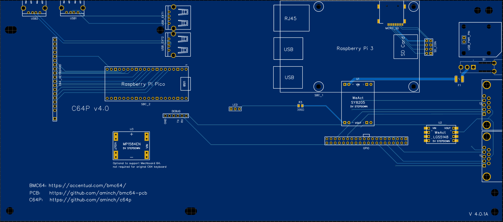
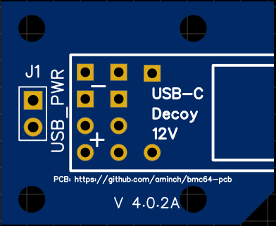
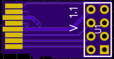
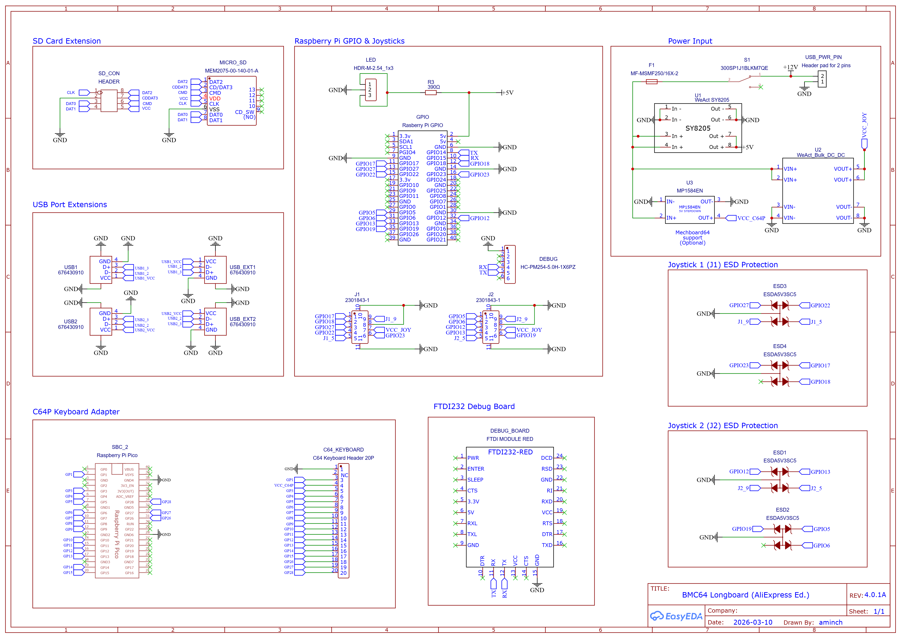
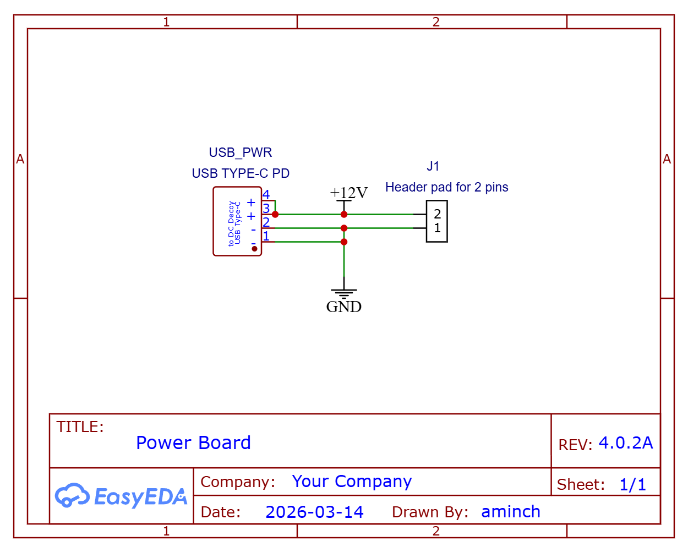
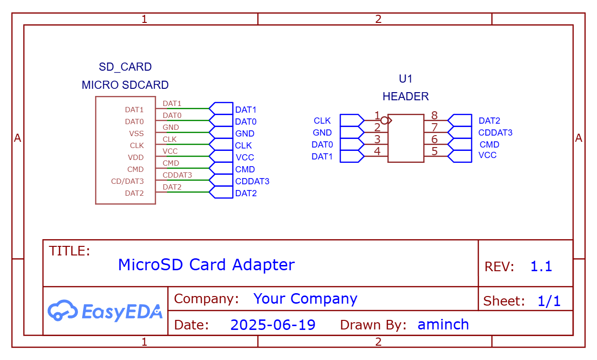
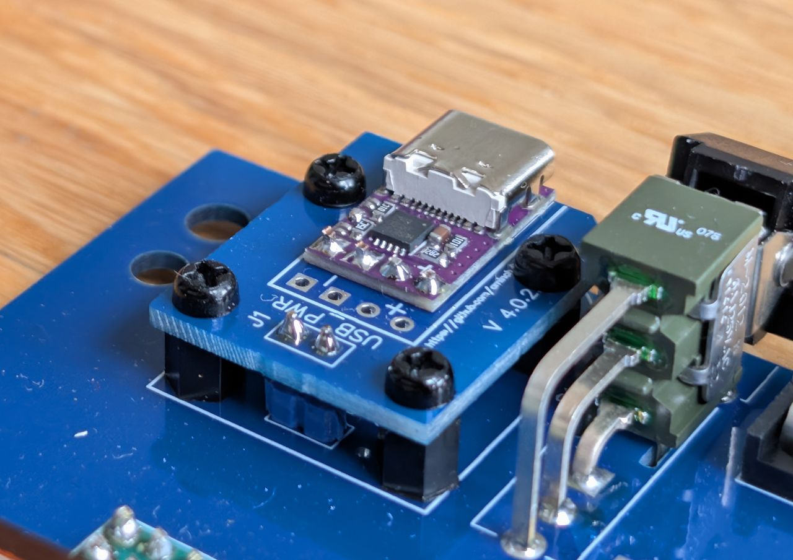
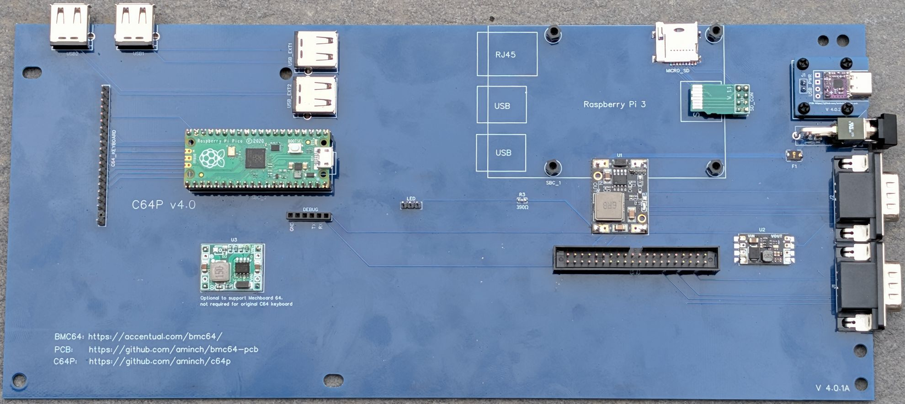

# BMC64 PCB (Longboard v4 AliExpress Edition)

This Longboard *AliExpress Edition* README contains details on the longboard AliExpress Edition variant of the BMC64 PCB.

This differs from the standard [longboard](LONGBOARD.md), in that all of the power system has been replaced with 4 pre-manufactured boards available from AliExpress. 

The changes are: 

 * 12V USB-C PD for more robust power delivery
 * 3 Buck convertors for 5V power delivery
 * Easier soldering 

There are **NO** functional differences to the standard longboard.

---

- [BMC64 PCB (Longboard v4 AliExpress Edition)](#bmc64-pcb-longboard-v4-aliexpress-edition)
  - [PCBs \& Parts](#pcbs--parts)
    - [Main PCB - Longboard (AliExpress Edition)](#main-pcb---longboard-aliexpress-edition)
    - [USB-C PD Power adapter board](#usb-c-pd-power-adapter-board)
    - [MicroSD card adapter board](#microsd-card-adapter-board)
    - [BOM](#bom)
    - [Ordering PCBs](#ordering-pcbs)
    - [Schematics](#schematics)
  - [Assembly](#assembly)
  - [Software](#software)
  - [History](#history)
  - [Disclaimer](#disclaimer)

## PCBs & Parts

### Main PCB - Longboard (AliExpress Edition)

### USB-C PD Power adapter board

The USB-C PD power adapter board is used to raise up the USB-C port to align corrected with the C64 cases

### MicroSD card adapter board

 The adapter board is used to connect the MicroSD slot on the Raspberry Pi 3B+ to the main PCB

### BOM

Full [BOM (AliExpress Edition)](bom/aliexpress-ed-bom.md) of parts needed.

### Ordering PCBs

I ordered the PCBs via [JLCPCB](https://jlcpcb.com/) with just the standard settings. The main PCB and power board was the standard 1.6mm thick, but it is important to order the MicroSD adapter board in **0.6mm** or **0.8mm** thick or it will be too big to fit into the microSD slot on the Raspberry Pi 3B+!

Check the [Releases](https://github.com/aminch/bmc64-pcb/releases/tag/V2.0.5), or `gerbers` folder for the gerber files.

### Schematics

## Assembly

Assemble the USB-C power board and attach it to the main pcb.

 * Prepare the main pcb:
   * Cut a 1x2 header from the 1x20 header and solder it into the USB_PWR_PIN on the main pcb.
   * Bolt the 4 nylon stand-offs (5mm high) into the holes around the soldered 1x2 header.
 * Prepare the power pcb:
   * Cut a 1x4 header from the 1x20 header,
   * Place a small piece of double sided tape on the underside of the USB-C PD module
   * Position the USB-C PD module on the power board by inserting the header pins through the holes (plastic up) making sure the port aligns to the edge of the pcb.
   * Flip the power board and solder the header pins on the bottom side.
   * Flip the power board again and remove the plastic from the topside of the pins and then solder.
   * Trim any excess length on the pins
 * Attaching the power pcb to the main pcb:
   * Place the power board over the 1x2 header and secure in place with the screws into the nylon stand-offs.
   * Solder the 1x2 header to the power board.
   * Done!

It should look like the picture below when complete.

Note: There are multiple holes in the power pcb to accommodate different USB-C PD modules. I have tested the two listed in the [BOM](/bom/aliexpress-ed-bom.md). 

---

Next attach the step-down modules to the board. The simplest method is:

 * Cut single 1x1 header pins from the 1x20 header.
 * Align the SY8205 on the board and insert one header pin per corner (plastic up).
 * Hold in place with tape over the pins and flip the board.
 * Solder the pins on the bottom of the pcb.
 * Flip the board over, and remove the plastic from the top of the pins.
 * Check alignment then solder the pins on the top and trim to length.

Repeat above for the MP1584EN, if you need Mechboard support, otherwise it can be left blank.

The LGS5148 can be soldered to the board without pins. Just align the module and solder between the castellated edges of the module and the main pcb.

---

From there you can follow the assembly instructions in the main [README](README.md#assembly) noting that this board has single USB2 ports, and 2x 1x20 female headers for mounting the Raspberry Pi Pico. The final assembled board should look as shown below.

The board will fit inside a C64C or breadbin case and all ports, the power switch and USB-C power connector use the existing holes in the case. It is mounted using screws to the existing stand-offs inside the case. 

## Software

See [Software](README.md#software) for full details

## History

See [History](README.md#history) for full details

## Disclaimer

This project is just a fun personal experiment for education and is not intended for professional or commercial use. I'm not an electrical engineer, so please use any information, code, or designs here at your own risk. 
